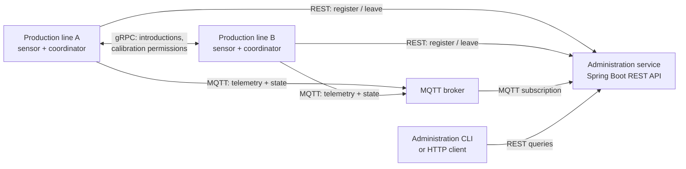

# SmartFab

**A distributed smart-factory simulation for real-time production-line monitoring and coordinated maintenance.**

SmartFab simulates independent production lines that monitor vibration readings, exchange telemetry, and coordinate exclusive access to a shared calibration resource. Each line operates as its own process, while a central administration service provides discovery, state monitoring, and historical queries within the running session.

Built in **Java** using **Spring Boot, REST, gRPC, Protocol Buffers, MQTT, and Gradle**.

## Highlights

- **Distributed coordination:** lines negotiate calibration access through peer-to-peer gRPC calls. Requests are prioritized by fault criticality, with a deterministic tie-breaker.
- **Live sensor processing:** simulated vibration measurements are processed in overlapping sliding windows (8 samples, 4-sample overlap); averages above a threshold trigger calibration.
- **Real-time monitoring:** each line publishes telemetry and state transitions via MQTT; the administration service maintains the latest line states and recorded readings.
- **Dynamic membership:** production lines register, discover peers, handle new arrivals during a pending calibration request, and notify peers when leaving.
- **Concurrency and recovery:** threaded sensor acquisition, coordinated state transitions, and checks for pending peer permissions and releases.
- **Automated tests:** unit tests and loopback gRPC integration scenarios cover data processing, API behavior, concurrent coordination, and join/leave cases.

## Architecture



Each production line hosts a **gRPC server** and a local calibration coordinator. The administration service registers active lines and exposes read-only monitoring endpoints; **calibration decisions are made between peers**, not by the administration service.

A line moves between three states:

`FullyOperational` → `WaitingForCalibration` → `UnderCalibration` → `FullyOperational`

When multiple lines need calibration, each must obtain the necessary peer permissions before starting. A higher relative threshold exceedance wins priority; the line ID breaks ties. New members are included in a request already in progress, while controlled departures clean up outstanding coordination state.

## Quick start

### Requirements

- **JDK 17+**
- **Docker with Compose** for the included local MQTT broker, **or** a separately running MQTT broker
- Free local ports **8080**, **1883**, and **50051–50053** for the example below

The Gradle wrapper is bundled; a system-wide Gradle installation is not required.

### 1. Start the MQTT broker

```bash
docker compose up -d
```

The included Mosquitto configuration is **for local development only**: anonymous connections are enabled, and Docker exposes the port only on `127.0.0.1`. Alternatively, start your own broker on `tcp://localhost:1883`.

### 2. Start the administration service

In a separate terminal:

```bash
./gradlew runAdministrationServer
```

The REST API is available at `http://localhost:8080`.

### 3. Start multiple production lines

In three more terminals:

```bash
./gradlew runProductionLine --args="1 localhost 50051 localhost 8080"
./gradlew runProductionLine --args="2 localhost 50052 localhost 8080"
./gradlew runProductionLine --args="3 localhost 50053 localhost 8080"
```

Run **one command per terminal**, so all three lines remain active. Each line simulates sensor readings, publishes telemetry, and communicates directly with the other lines. Type `exit` in a line's terminal to remove it gracefully.

### 4. Inspect the system

Start the interactive administration client in another terminal:

```bash
./gradlew runAdministrationClient
```

Or query the API directly:

```bash
curl http://localhost:8080/production-lines
curl http://localhost:8080/production-lines/states
```

## REST API

| Method | Endpoint | Purpose |
| --- | --- | --- |
| `POST` | `/production-lines` | Register a line and discover existing peers |
| `GET` | `/production-lines` | List registered lines |
| `GET` | `/production-lines/states` | View the current operational state of each line |
| `GET` | `/production-lines/{id}/average?t1=...&t2=...` | Average vibration readings in an inclusive Unix-millisecond time interval |
| `DELETE` | `/production-lines/{id}` | Unregister a line |

The average endpoint returns `204 No Content` if the selected interval contains no measurements and `404 Not Found` if the line is not registered. Telemetry is maintained **in memory**, so it is cleared on server restart.

## Development and testing

```bash
./gradlew test
./gradlew build
```

JUnit tests cover calibration permissions, requests involving joining or leaving peers, gRPC integration, MQTT message handling, sensor windows, telemetry aggregation, and the administration endpoints. GitHub Actions runs the test task for pushes and pull requests.

**IntelliJ IDEA:** open the repository as a Gradle project. Shared run configurations are provided under `.run/` for the administration server, administration client, five individual production lines, and an `Initial Lines` compound configuration for lines 1–3.

For a broker at a different address, pass the JVM property `-Ddps.mqtt.broker=tcp://HOST:1883` to the administration service and each production line.

## Repository layout

```text
src/main/java/dps/administration/       REST API and monitoring state
src/main/java/dps/administrationclient/ Console-based administration client
src/main/java/dps/productionline/       Line lifecycle and peer membership
src/main/java/dps/productionline/calibration/ Distributed calibration protocol
src/main/java/dps/productionline/grpc/   Peer-to-peer gRPC handlers and clients
src/main/java/dps/productionline/mqtt/   MQTT publishing
src/main/java/dps/productionline/telemetry/ Sensor processing and sliding windows
src/main/java/sensor/                   Simulated vibration sensor
src/main/proto/                         Protobuf and gRPC service definitions
src/test/                               Unit and integration tests
.run/                                   Shared IntelliJ run configurations
infra/                                  Local MQTT broker configuration
.github/workflows/                      Continuous integration
```

## Scope

This is a **simulation and educational engineering project**, not a production-ready industrial control system. Sensor values are generated locally; registration and telemetry are held in memory; MQTT uses a development broker by default. The focus is on network protocols, peer coordination, concurrent execution, and system design.
